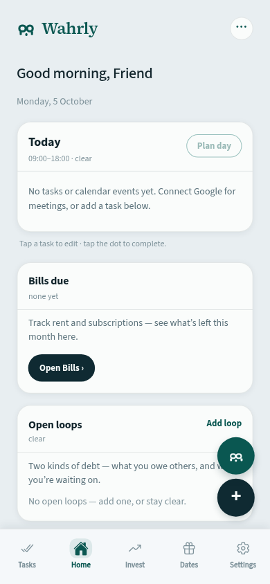
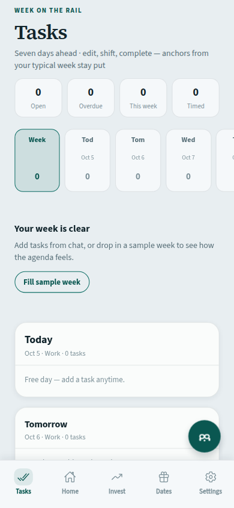
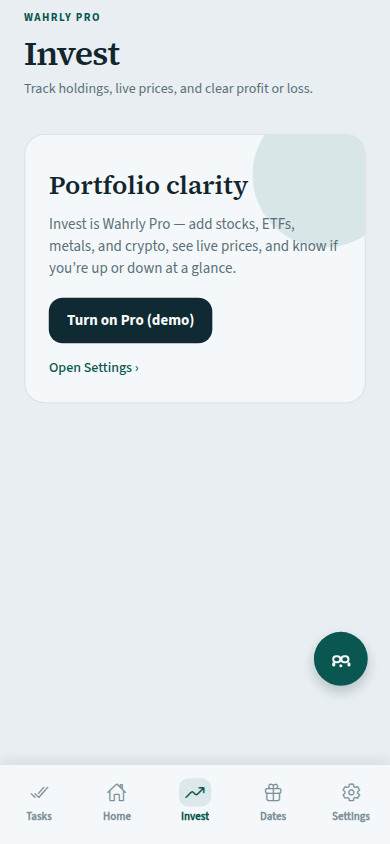
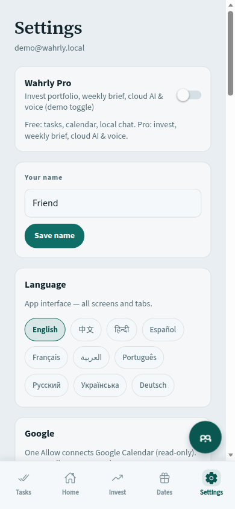
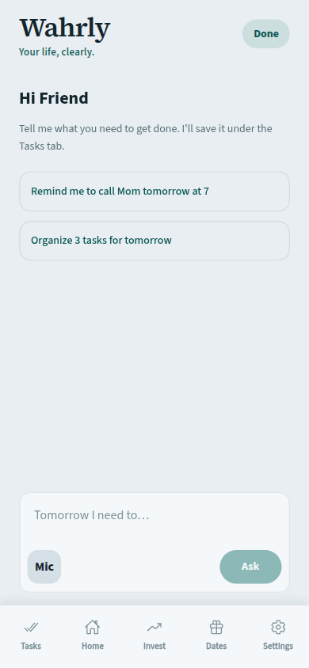
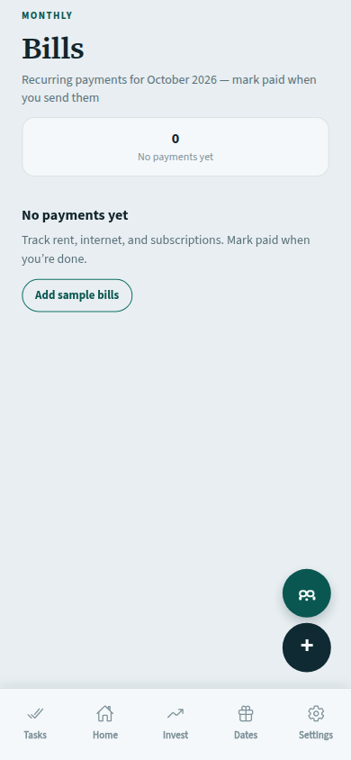

# Wahrly — TestFlight (build 42 / 1.1.0)

Материалы для App Store Connect → TestFlight: описание, What to Test, Free/Pro, скрины.

---

## Beta App Description (коротко)

**RU**

Wahrly — ассистент дня: задачи, счета, Google Calendar (только чтение), даты, новости и локальный AI. Free закрывает день сам (Home + Evening Clear). Pro — Plan day, утренний brief, напоминания, виджет, облачный чат, голос и Invest. Почту не читаем.

**EN**

Wahrly is a daily life assistant: tasks, bills, Google Calendar (readonly), dates, news, and on-device AI. Free closes the day yourself (Home + Evening Clear). Pro unlocks Plan day, morning brief, reminders, widget, cloud chat, voice, and Invest. No email access.

---

## What to Test (RU) — вставить в TestFlight

```
Wahrly 1.1.0 (build 42) — MVP life assistant

ЧТО ПРОВЕРИТЬ
1) Onboarding / имя / язык (RU или EN) — финал ведёт на Home, не на Plan day.
2) Tasks: создай задачу на сегодня, перенеси на завтра, отметь done.
3) Free Home: next-задача, таймлайн, Evening Clear. Кнопка Plan day — только Pro.
4) Open loops: добавь «я должен» и «жду» (можно с optional due).
5) Settings → Connect with Google: только Calendar (readonly). Почта НЕ читается.
   Если раньше подключал Gmail: Disconnect → Connect заново.
6) Вкладки: Tasks · Home · Bills · Dates · Settings (Invest не в таб-баре).
7) Bills: добавь счёт, отметь paid.
8) Dates / Life: важная дата и документ с сроком.
9) News: интересы и лента «вчера» (через Quick actions / Life).
10) Free vs Pro (Settings → Pro / IAP или demo unlock):
    Free: задачи, календарь, Bills, локальный чат, Evening Clear (простой).
    Pro: Plan day, morning brief, reminders, виджет, cloud AI, голос, Invest, weekly brief.
11) Invest (Pro): Quick actions → Invest — набери «gold» или «bitcoin», live-цена.
12) Пуши: evening Free; morning / bills reminders — Pro. Разрешить уведомления.
13) Виджет «Next task» — Pro.

НЕ БАГ
• Почта / Gmail отсутствуют намеренно (без CASA).
• Plan day / Invest / виджет закрыты на Free — это hard split, не баг.
• Иконка в старых пушах может быть старой до перезагрузки iPhone — на Home должна быть бирюзовая W.

ОТЧЁТ
Напиши: устройство + iOS, что ок / что сломано, скрин при баге.
```

---

## What to Test (EN)

```
Wahrly 1.1.0 (build 42) — MVP life assistant

PLEASE TRY
1) Onboarding / name / language — ends on Home (not Plan day).
2) Tasks: create, reschedule, complete.
3) Free Home: next task, timeline, Evening Clear. Plan day CTA is Pro-only.
4) Open loops: “I owe” + “Waiting” (optional due date ok).
5) Settings → Connect with Google — Calendar readonly only (no mail).
   If you connected Gmail before: Disconnect → Connect again.
6) Tabs: Tasks · Home · Bills · Dates · Settings (Invest is off the tab bar).
7) Bills / Dates / Life / News.
8) Free vs Pro (Settings → Pro / IAP or demo unlock):
   Free = tasks, calendar, bills, on-device chat, simple Evening Clear.
   Pro = Plan day, morning brief, reminders, widget, cloud AI, voice, Invest, weekly brief.
9) Invest (Pro): Quick actions → Invest — type “gold” or “bitcoin”, confirm live price.
10) Notifications (evening Free; morning/bill reminders Pro) + optional Home Screen widget (Pro).

NOT A BUG
• No email/Gmail by design.
• Plan day / Invest / widget locked on Free — intentional hard split.
• Stale notification icons: reboot iPhone; Home icon should be teal W.

Feedback: device + iOS + what broke (screenshot helps).
```

---

## Free vs Pro

Aligned with `lib/pro.ts` (hard split).

| | Free | Pro |
|--|:----:|:----:|
| Tasks / Bills / Dates / News / Life | ✅ | ✅ |
| Calendar readonly | ✅ | ✅ |
| Open loops (manual) | ✅ | ✅ |
| Local AI chat | ✅ | ✅ |
| Evening Clear (simple done / tomorrow + closed-today lite) | ✅ | ✅ |
| Evening digest reflect journal | ❌ | ✅ |
| Open loop optional due date | ✅ | ✅ |
| Plan day (auto slots) | ❌ | ✅ |
| Smart morning brief | ❌ | ✅ |
| Bill & loop reminders | ❌ | ✅ |
| Home Screen widget | ❌ | ✅ |
| Cloud AI chat | ❌ | ✅ (~400/day) |
| Voice | ❌ | ✅ (~200/day) |
| Invest + live quotes | ❌ | ✅ |
| Weekly brief | ❌ | ✅ |

Primary tabs for everyone: **Tasks · Home · Bills · Dates · Settings**. Invest is Pro-only via Quick actions.

---

## Скриншоты (iPhone viewport)

Сняты с веб-демо (Pages), для TestFlight notes и внутренней презентации. Для витрины App Store лучше переснять с реального iPhone (6.7").

| # | Экран | Файл |
|---|--------|------|
| 1 | Home | [01-home.png](./testflight-screens/01-home.png) |
| 2 | Tasks | [02-tasks.png](./testflight-screens/02-tasks.png) |
| 3 | Invest (Pro gate) | [03-invest.png](./testflight-screens/03-invest.png) |
| 4 | Settings (Pro + языки + Google) | [04-settings.png](./testflight-screens/04-settings.png) |
| 5 | Chat | [05-chat.png](./testflight-screens/05-chat.png) |
| 6 | Bills | [06-bills.png](./testflight-screens/06-bills.png) |

### Preview













---

## Куда вставить в App Store Connect

1. **Users and Access / TestFlight** → приложение Wahrly → build **42**  
2. **Test Details** → *What to Test* → вставь блок RU или EN выше  
3. *Beta App Description* → короткий абзац  
4. Скрины из `testflight-screens/` можно приложить в письмо тестерам или во внутренний Notion/Telegram
